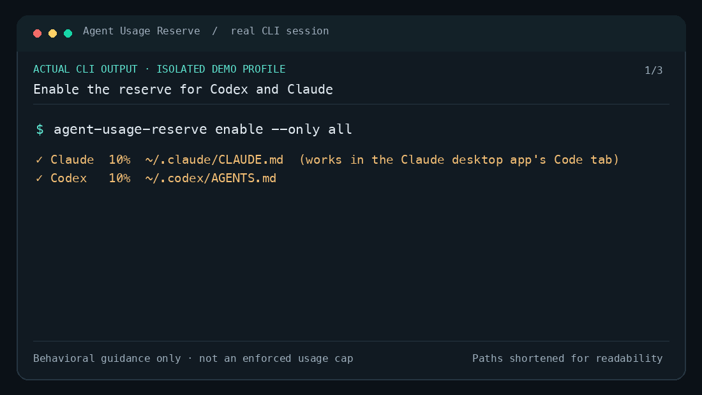

# Agent Usage Reserve

`agent-usage-reserve` manages a small usage-reserve policy in your global Codex and Claude Code instructions. It is an unofficial local utility. It has no service, telemetry, API-key access, credential scraping, or background polling.

## Demo



Actual CLI output · isolated demo profile with both agents. The demo configures agent guidance; it is not an enforced usage cap. Temporary paths are shortened for readability.

## Quick start

Install with Homebrew on macOS or Linux:

```sh
brew install taejunoh/tap/agent-usage-reserve
agent-usage-reserve enable
```

Homebrew installs the executable only; `enable` activates the policy. To install and enable in one step instead, use the direct installer on macOS/Linux:

```sh
curl -fsSL https://raw.githubusercontent.com/taejunoh/agent-usage-reserve/main/install.sh | sh
```

On Windows PowerShell:

```powershell
irm https://raw.githubusercontent.com/taejunoh/agent-usage-reserve/main/install.ps1 | iex
```

`enable` looks for your Codex home (`~/.codex`, or `CODEX_HOME`) and your Claude home (`~/.claude`, or `CLAUDE_CONFIG_DIR`). If it finds one, it applies the policy there; if it finds both and neither is enabled yet, it asks whether to use Both, Claude only, or Codex only (pressing Enter chooses Both). Repeating `enable` keeps agents that are already enabled, and asks before adding a newly found one. To skip the question, use `--only claude`, `--only codex`, or `--only all`. Without an interactive terminal it changes nothing and prints the `--only` commands to run instead; the direct installer then still reports that the executable was installed.

Direct installers verify the release checksum and executable version, install to a user directory, then automatically run `enable`. They do not use `sudo` or modify shell startup files. Unix installs to `~/.local/bin`; Windows installs to `%LOCALAPPDATA%/Programs/agent-usage-reserve/bin`. Add the printed Windows directory to your user `PATH`, or run the printed `$env:Path = "...;$env:Path"` command for the current PowerShell session.

Installing and running the released executable requires no Go, Node, Python, or API keys.

## Update

To update a direct install, rerun the same installer for your platform. It runs `enable` without a threshold, preserving each enabled agent's custom threshold.

```sh
curl -fsSL https://raw.githubusercontent.com/taejunoh/agent-usage-reserve/main/install.sh | sh
```

On Windows, rerun the PowerShell installer:

```powershell
irm https://raw.githubusercontent.com/taejunoh/agent-usage-reserve/main/install.ps1 | iex
```

For Homebrew, update the tap and formula, check the policy, and enable it if needed:

```sh
brew update
brew upgrade taejunoh/tap/agent-usage-reserve
agent-usage-reserve status
agent-usage-reserve enable  # if status says disabled; keeps the current threshold
```

## Commands

```text
agent-usage-reserve enable  [--threshold 10] [--only claude|codex|all] [--codex-home PATH] [--claude-home PATH]
agent-usage-reserve set 15  [--only claude|codex|all] [--codex-home PATH] [--claude-home PATH]
agent-usage-reserve status  [--only claude|codex|all] [--codex-home PATH] [--claude-home PATH]
agent-usage-reserve disable [--only claude|codex|all] [--codex-home PATH] [--claude-home PATH]
agent-usage-reserve --version
```

Thresholds are whole percentages from 1 to 99, stored separately for each agent. Repeating `enable` without `--threshold` keeps each agent's current threshold. `set` and `disable` without `--only` act on every enabled agent; `set` changes an enabled policy. `status` lists every detected agent and reports the managed policy and its target file; it does not check account usage or verify model behavior.

The tool updates only its marked policy block. For Codex that is the effective global `AGENTS.override.md` or `AGENTS.md` under your Codex home; for Claude it is `CLAUDE.md` in your Claude home. It keeps a private backup of the original file in that agent's home directory before each mutation. `disable` removes the managed block while preserving unrelated text. Before replacement, the tool checks whether the target changed during its operation; this catches many external edits but cannot serialize unrelated editors or guarantee detection of every concurrent write. Disabling the policy and uninstalling the executable are separate: run `disable`, then remove the binary or run `brew uninstall taejunoh/tap/agent-usage-reserve`.

### Backup recovery

Prefer `agent-usage-reserve disable` to remove the managed block. Backups are named `.agent-usage-reserve-backup-*` and live in each agent's own home directory (Codex home and Claude home). Find them on macOS/Linux with:

```sh
codex_home=${CODEX_HOME:-"$HOME/.codex"}
claude_home=${CLAUDE_CONFIG_DIR:-"$HOME/.claude"}
find "$codex_home" "$claude_home" -type f -name '.agent-usage-reserve-backup-*' -print
```

Inspect the selected backup and current target first. A full restore replaces the entire instruction file and can erase edits made after that backup. Make a copy of the current target before an intentional full restore. A backup belongs to the home directory it is in: restore it only to that agent's file. For Codex, choose the actual active target (`AGENTS.md` or `AGENTS.override.md`) printed by `status`; for Claude, the target is `CLAUDE.md`.

```sh
backup='/full/path/to/.agent-usage-reserve-backup-...'
target="$codex_home/AGENTS.md" # use AGENTS.override.md when that is the active Codex target
# For a Claude backup: target="$claude_home/CLAUDE.md"
diff -u "$target" "$backup" || true
cp -p "$target" "$target.before-restore"
cp -p "$backup" "$target" # only when you intend to restore the complete file
```

On Windows PowerShell, list backups and review the selected backup and target:

```powershell
$codexHome = if ($env:CODEX_HOME) { $env:CODEX_HOME } else { Join-Path $HOME '.codex' }
$claudeHome = if ($env:CLAUDE_CONFIG_DIR) { $env:CLAUDE_CONFIG_DIR } else { Join-Path $HOME '.claude' }
Get-ChildItem -Force -File $codexHome, $claudeHome -Filter '.agent-usage-reserve-backup-*' |
  Sort-Object LastWriteTime -Descending
```

```powershell
$backup = 'C:\full\path\to\.agent-usage-reserve-backup-...'
$target = Join-Path $codexHome 'AGENTS.md' # use AGENTS.override.md when that is the active Codex target
# For a Claude backup: $target = Join-Path $claudeHome 'CLAUDE.md'
Get-FileHash -LiteralPath $backup, $target
Copy-Item -LiteralPath $target -Destination "$target.before-restore"
Copy-Item -LiteralPath $backup -Destination $target -Force # only for an intentional full-file restore
```

Copy only the bytes you intend to restore if you need to preserve later edits. Backups from before the rename are named `.codex-usage-reserve-backup-*`; the tool leaves them in place, and the same steps apply with that name.

## Scope and limits

The policy guides the agent to check the available account usage limits before ordinary work and between major stages. Actual scheduled runs are exempt. An explicit request to continue applies only to the named task, or the current task if none is named. A user-specified temporary threshold takes precedence. Subagents skip the check; the main session handles it.

This is behavioral guidance, not a hard account cap. It can only use usage data and tools available to the current environment, and it does not promise that every run has those tools. Missing usage data is reported without guessing. It does not include any user's custom model-selection or delegation policies.

- **Codex:** works where the Codex desktop or task environment exposes the account usage limits; it does not promise that every CLI or scheduled run has them.
- **Claude Code:** works in the Claude desktop app's Code tab, which exposes the usage tool. The terminal `claude` CLI exposes no usage tool, so there the policy only discloses that usage is unavailable.

## Existing codex-usage-reserve users

This tool was renamed from `codex-usage-reserve` and now manages Codex and Claude Code.

- **Homebrew:** `brew update` then `brew upgrade taejunoh/tap/agent-usage-reserve`. The tap renames the old formula, so the upgrade migrates automatically.
- **Direct installer:** rerun the installer. It removes the old `codex-usage-reserve` executable from the install directory (on Windows also from the old default directory, and suggests removing that directory from your user `PATH`), because the old executable cannot see the new policy marker.
- **Your existing policy** keeps working. It is converted to the new marker the next time you run `enable` or `set`, keeping its threshold.
- **After upgrading, run `agent-usage-reserve enable` once** (Homebrew or not). `status` already shows Codex as enabled, but `enable` adds Claude and converts the old marker to the new one.
- Old `.codex-usage-reserve-backup-*` files are kept untouched.

The old one-line install commands keep working through GitHub's redirect after the repository rename.

## For developers

### Build and enable from source

Go 1.23 or newer is required to build from source.

```sh
mkdir -p "$HOME/.local/bin"
go build -o "$HOME/.local/bin/agent-usage-reserve" ./cmd/agent-usage-reserve
"$HOME/.local/bin/agent-usage-reserve" enable
```

The default threshold is 10% remaining. The command prints the instruction file it changed for each agent. If `$HOME/.local/bin` is not on `PATH`, add it in your shell configuration yourself.

To prepare a release, `scripts/build-release.sh 0.2.0` creates six platform archives and their real SHA-256 entries in `dist/`. The tagged GitHub Actions workflow uses those files to publish the Release.

Generate a Homebrew formula from the release checksum manifest in a separate tap checkout. `--renames` also writes `formula_renames.json`, which maps the old formula name to the new one:

```sh
python3 scripts/generate-formula.py 0.2.0 dist/checksums.txt ../homebrew-tap/Formula/agent-usage-reserve.rb --renames ../homebrew-tap/formula_renames.json
```

The generator requires real checksums for all six release archives and embeds the macOS/Linux asset URLs and hashes. Review and publish the generated formula in the separate tap repository.

To regenerate the demo GIF and transcript, build the binary and run the script (it needs Python with Pillow and a monospace font):

```sh
go build -o /tmp/agent-usage-reserve ./cmd/agent-usage-reserve
AGENT_USAGE_RESERVE_DEMO_BINARY=/tmp/agent-usage-reserve python3 scripts/generate-demo.py
```
